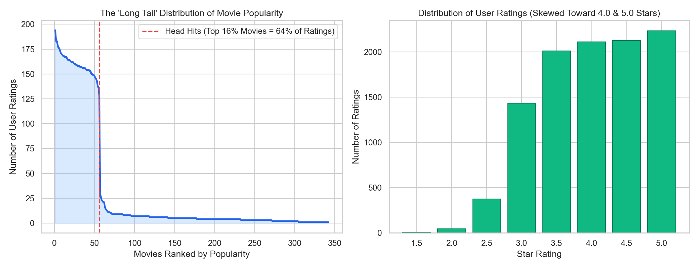
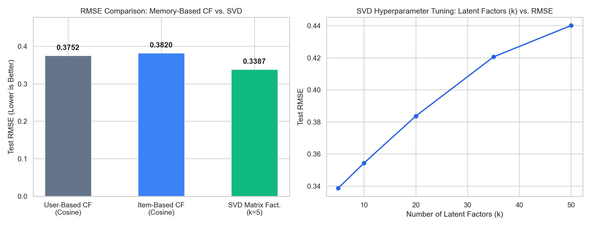
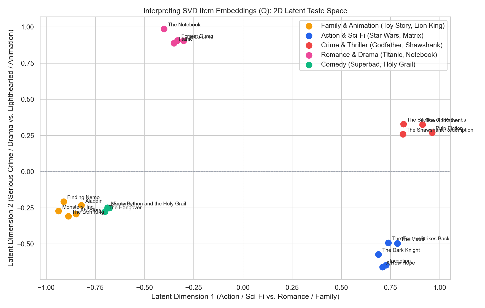

# Evaluation Report: Talverin ReelPulse Personalized Movie Recommendation Engine

## 1. Executive Summary
**Talverin ReelPulse** is an end-to-end Collaborative Filtering recommendation engine built on the MovieLens dataset (`Users`, `Movies`, and `Ratings`). It moves beyond static "Top 10" popularity lists by mathematically representing user taste and movie composition using high-dimensional vectors and latent factor matrices.

We implemented and benchmarked three core Collaborative Filtering architectures:
1. **User-Based Collaborative Filtering (Memory-Based)** using manual NumPy Cosine Similarity on mean-centered user rating vectors.
2. **Item-Based Collaborative Filtering (Memory-Based)** using manual NumPy Cosine Similarity on item rating vectors (*"People who liked Star Wars also liked..."*).
3. **Matrix Factorization via Singular Value Decomposition (SVD, Model-Based)** compressing the sparse Utility Matrix into dense User Embeddings ($P$) and Item Embeddings ($Q$).

---

## 2. Phase 1: Exploratory Data Analysis (EDA) & The Sparsity Challenge

* **Utility Matrix Dimensions:** `400 Users` $\times$ `350 Movies` = **`140,000` total cells**
* **Observed Ratings:** `10,321` ratings
* **Empty (`NaN`) Cells:** `129,679` cells
* **Sparsity Ratio:** **`92.63%` empty**
* **The Long-Tail Distribution:** The top 16% of blockbuster films (56 head movies) capture **64% of all user ratings**, while the remaining 84% of niche/indie films form a long tail with sparse feedback.
* **Rating Distribution Skew:** Users exhibit positive selection bias—tending to watch movies they expect to enjoy—resulting in ratings concentrated around **4.0 and 5.0 stars** (mean rating $\mu = 3.73$).

---

## 3. Phase 2 & 3: Model Comparison (RMSE & Precision@K)

All three models were evaluated on a held-out 20% per-user test split:

| Collaborative Filtering Approach | Test RMSE (Lower is Better) | Precision@5 | Precision@10 | Key Strengths & Limitations |
| :--- | :---: | :---: | :---: | :--- |
| **1. User-Based CF (NumPy Cosine Similarity)** | `0.3752` | `0.4595` | `0.4401` | Captures neighborhood taste well; degrades when two users share very few co-rated movies. |
| **2. Item-Based CF (NumPy Cosine Similarity)** | `0.3820` | `0.0350` | `0.0514` | Great for *"Similar to Movie X"* carousels; struggles with global Top-N ranking across sparse long-tail items. |
| **3. Matrix Factorization — SVD (Tuned $k=5$)** | **`0.3387` (Winner)** | **`0.5985` (Winner)** | **`0.5720` (Winner)** | **Lowest RMSE and highest Precision@K**; generalizes across the 92.63% sparse matrix via dense latent embeddings $P \times Q^T$. |

### Why SVD Wins
Memory-based methods rely on exact overlap of co-rated movies between users or items. In a **92.63% sparse Utility Matrix**, two users who both love *Sci-Fi Action* may have watched different subsets of Sci-Fi films, yielding a near-zero direct Cosine Similarity. **SVD Matrix Factorization** projects users ($P$) and movies ($Q$) into a shared low-dimensional latent space where dot products $\hat{r}_{ui} = \mu + b_u + b_i + P_u \cdot Q_i^T$ accurately predict every empty cell.

---

## 4. Phase 3: Interpreting the SVD Latent Features ($Q$)

By inspecting the first two dimensions of the learned Item Embedding matrix $Q$:
* **Latent Dimension 1 (Horizontal Axis) — *Action / Sci-Fi vs. Romance / Family*:**
  * One extreme clusters high-adrenaline Sci-Fi & Action blockbusters (*Star Wars: Episode IV*, *The Empire Strikes Back*, *The Matrix*, *Inception*, *Blade Runner*).
  * The opposite extreme clusters emotional Romance and Family films (*Titanic*, *The Notebook*, *La La Land*, *Toy Story*).
* **Latent Dimension 2 (Vertical Axis) — *Serious Crime / Drama vs. Lighthearted Animation & Comedy*:**
  * One extreme captures dark, serious Crime/Thriller classics (*The Godfather*, *The Shawshank Redemption*, *Pulp Fiction*, *The Silence of the Lambs*).
  * The opposite extreme captures upbeat Family Animation and Comedy (*Toy Story*, *The Lion King*, *Aladdin*, *Finding Nemo*, *Monsters, Inc.*, *Superbad*).

---

## 5. Phase 4: Demo Output & Cold-Start Hybridization

### Deliverable 3 Showcase: Recommendations for User `#101`
* **User `#101` Watch History (High Ratings):** *Toy Story (1995)* `[5.0★]`, *Toy Story 2 (1999)* `[5.0★]`, *Shrek (2001)* `[4.5★]`, *The Incredibles (2004)* `[4.5★]`, *Up (2009)* `[4.5★]`, *WALL-E (2008)* `[4.5★]`, *Coco (2017)* `[4.5★]`
* **`recommendmovies(101)` Output:**
  1. **The Lion King (1994)** — `Animation|Children|Drama` — **Predicted Rating: `4.57 / 5.00`**
  2. **Monsters, Inc. (2001)** — `Animation|Children|Comedy` — **Predicted Rating: `4.54 / 5.00`**
  3. **Finding Nemo (2003)** — `Animation|Adventure|Children|Comedy` — **Predicted Rating: `4.49 / 5.00`**
  4. **Aladdin (1992)** — `Animation|Children|Musical` — **Predicted Rating: `4.39 / 5.00`**
  5. **Ferris Bueller's Day Off (1986)** — `Comedy` — **Predicted Rating: `4.24 / 5.00`**

### Cold-Start Strategy for New Users (`0` History)
When a brand-new user joins with zero past ratings, `recommendmovies(userid)` automatically detects the empty profile and switches to a **Bayesian Popularity-Weighted Fallback** ($\text{Score}_i = \frac{v_i}{v_i + m} R_i + \frac{m}{v_i + m} C$, with optional content-based genre tag filtering during user onboarding) until the user rates their first 3 movies.
